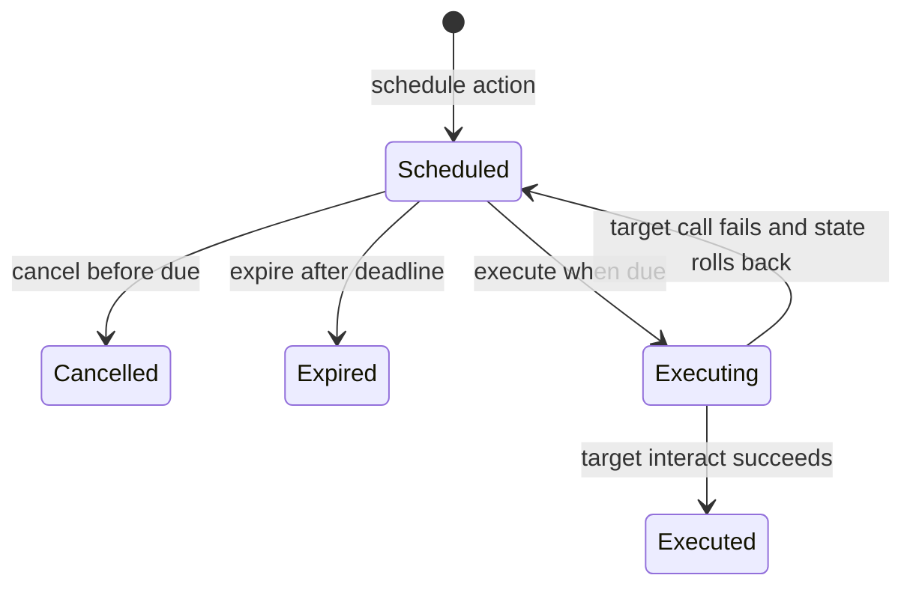

# Scheduled Actions

Allowlisted delayed-call scheduler for contracts that want time-gated execution
without embedding bespoke queue logic.

## Status

`candidate`

## Contracts

- `src/con_scheduled_actions.py`: schedules, cancels, and executes delayed
  contract calls against an allowlisted target set

## Notes

- Execution is caller-triggered. Nothing runs automatically; a caller must
  execute a due action.
- Target contracts must be explicitly allowlisted by the operator.
- Scheduled targets are invoked through a fixed exported
  `interact(payload: dict)` entrypoint instead of arbitrary function dispatch.
- Scheduled actions can be rescheduled, expired explicitly, and are marked
  `executing` before cross-contract calls to avoid simple replay/reentrancy
  races.
- This is intentionally narrower than a cron system. It is a reusable delayed
  execution primitive, not a full automation framework.
- The contract stores payloads on-chain and replays them at execution
  time, so callers should avoid placing secrets in scheduled payloads.

## Validation

- repo-wide lint and compile checks
- package-local automated tests for due execution and expiry handling

## Payload hash format

New actions use `payload_hash_version: 2`. SHA3-256 hashes the UTF-8 text
`scheduled-actions:v2:` followed by a typed, length-prefixed encoding. Each frame
is a one-character tag, decimal character count, colon, and content. Dictionaries
(`m`) concatenate sorted string-key (`s`) frames and value frames; lists/tuples
(`l`) concatenate value frames. Sets (`e`) and frozen sets (`r`) sort encoded
members. Scalars use `n` (None, empty content), `b` (bool), `i` (int), `s` (str),
`d` (deterministic decimal), `f` (float), `t` (datetime), `u` (timedelta), `x`
(bytes hex) and `y` (bytearray hex). Scalar text uses the runtime's `str` form;
bools are tested before ints. Unsupported types and non-string dictionary keys
are rejected. Lengths count Unicode characters, not UTF-8 bytes.

Existing action records keep their stored hashes; absent version metadata reads
as version 1. Rescheduling does not rewrite a payload or its hash. The hash is
payload metadata; execution still reads the stored payload and enforces the
schedule, target allowlist, and action status.
